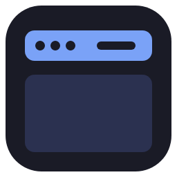
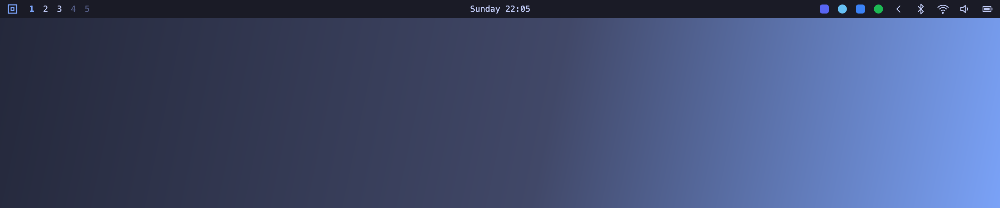
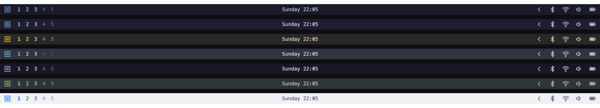

# Topstrip

**An [Omarchy](https://omarchy.org/manual/the-top-bar/)-style top bar for Windows.**

Workspaces, a centered clock, your tray apps and system status in one thin strip across the top of the screen.

[**Download**](https://github.com/mberrishdev/Topstrip/releases/latest) · [Report a bug](https://github.com/mberrishdev/Topstrip/issues/new?template=bug_report.yml) · [Request a feature](https://github.com/mberrishdev/Topstrip/issues/new?template=feature_request.yml)

## Features

- **Workspaces 1–5:** your Windows virtual desktops. Click a number to jump straight to it; Topstrip creates the desktop if it doesn't exist yet. Bright numbers have windows, dim ones are empty; hover to see the apps on a desktop.
- **Active app:** the app you're using and its window title, next to the workspaces.
- **Centered clock:** click for notifications and calendar, right-click to change the format.
- **Tray drawer:** hover the `‹` to reveal the apps that normally sit next to the Windows clock (Discord, Steam, OneDrive…). Left-, right- and middle-click them as usual.
- **Status:** Bluetooth, Wi-Fi signal, volume and battery.
- **Keyboard layout:** your input language (EN, KA…) next to the clock when you use more than one.
- **Copilot usage:** GitHub Copilot premium requests left this month (needs the [GitHub CLI](https://cli.github.com) signed in with `gh auth login`).
- **Real space reservation:** maximized windows stop below the bar, just like they stop above the taskbar. Fullscreen videos and games cover it.
- **Hide it any time:** **Win+Alt+T** (or **Hide Bar** in the menu) gives the space back; press it again to bring the bar back.
- **Every monitor:** show the bar on the main display, one display, or all of them.
- **Settings:** theme, transparency, clock format, which display, which widgets, shortcut, startup and updates.
- **11 themes:** Tokyo Night, Catppuccin, Catppuccin Latte, Everforest, Gruvbox, Kanagawa, Matte Black, Nord, Osaka Jade, Ristretto and Rosé Pine.

## Install

1. Download **`Topstrip-<version>-win-x64.zip`** from the [latest release](https://github.com/mberrishdev/Topstrip/releases/latest). On an ARM PC (Surface Pro X, Snapdragon laptops) take `-win-arm64.zip`.
2. Unzip it and run **`Topstrip.exe`**.

That's it. Topstrip installs itself for your user (no admin rights): it adds a Start menu entry and an entry in **Settings → Apps → Installed apps**, and turns on **Open at Login**.

Windows SmartScreen may warn about an unrecognized app the first time, because the exe isn't code-signed yet. Choose **More info → Run anyway**.

**Requirements:** Windows 10 or 11, 64-bit (x64 or ARM64).

For the exact Omarchy look, install a [Nerd Font](https://www.nerdfonts.com/) such as *JetBrainsMono Nerd Font*. Otherwise Topstrip uses Cascadia Mono or Consolas.

## Updates

Topstrip checks for a new version about once a day. When one is ready, an update badge appears next to the clock: click it and Topstrip updates and restarts. You can also choose **Check for Updates…** in the menu.

Want new features early? Turn on **Beta Updates** in the menu.

## Using it

| Widget | Left click | Right click | Other |
|---|---|---|---|
| Menu (logo) | Menu: Settings, theme, Hide Bar, apps, lock, restart, shut down | Open a terminal | |
| Workspaces | Switch to that desktop | | Hover: the apps on it |
| Clock | Notifications & calendar | Change format | |
| Keyboard layout | Next layout | Language settings | Only shown with 2+ layouts |
| Update badge | Install the update and restart | | Only shown when an update is ready |
| Copilot usage | Copilot settings on GitHub | Refresh | Hover: plan and reset date |
| Tray `‹` | | | Hover to show tray apps |
| Bluetooth | Bluetooth settings | Turn on / off | |
| Network | Wi-Fi list | | Icon shows signal strength |
| Audio | Sound settings | Mute | Scroll to change volume |
| Power | Power settings | Show battery % | |

Double-click an empty part of the bar to toggle transparency.

**Settings** (menu → Settings…, or start Topstrip again while it's running) has everything else: theme, transparency, clock format, battery percentage, which display the bar is on, which widgets to show, the hide/show shortcut, open at login and updates.

**Hide the bar** with **Win+Alt+T** (changeable in Settings) or **Hide Bar** in the menu. Press the shortcut again, or start Topstrip from the Start menu, to bring it back. To close it completely, choose **Quit Topstrip**.

Settings are stored in `%APPDATA%\Topstrip\settings.json`, and a log in `%APPDATA%\Topstrip\topstrip.log` (attach it to bug reports).

## FAQ

**Does it replace the Windows taskbar?**
No. The taskbar keeps working; Topstrip sits at the top. Many people set the taskbar to auto-hide.

**The Wi-Fi name doesn't show.**
On Windows 11 24H2 and later, apps need location access to read the network name. Signal strength works either way.

**How do I uninstall it?**
**Settings → Apps → Installed apps → Topstrip → Uninstall.** It asks whether to keep your settings.

**Can I run it without installing?**
Yes: put an empty file named `Topstrip.portable` next to `Topstrip.exe`, and it runs from where it is (no Start menu entry, no automatic install).

## Feedback

Found a bug or have an idea? [Open an issue](https://github.com/mberrishdev/Topstrip/issues/new/choose).

## Credits

Inspired by [Omarchy](https://omarchy.org)'s top bar. Tray support is ported from [Zebar](https://github.com/glzr-io/zebar)'s systray-util. See [third-party notices](THIRD-PARTY-NOTICES.md).
